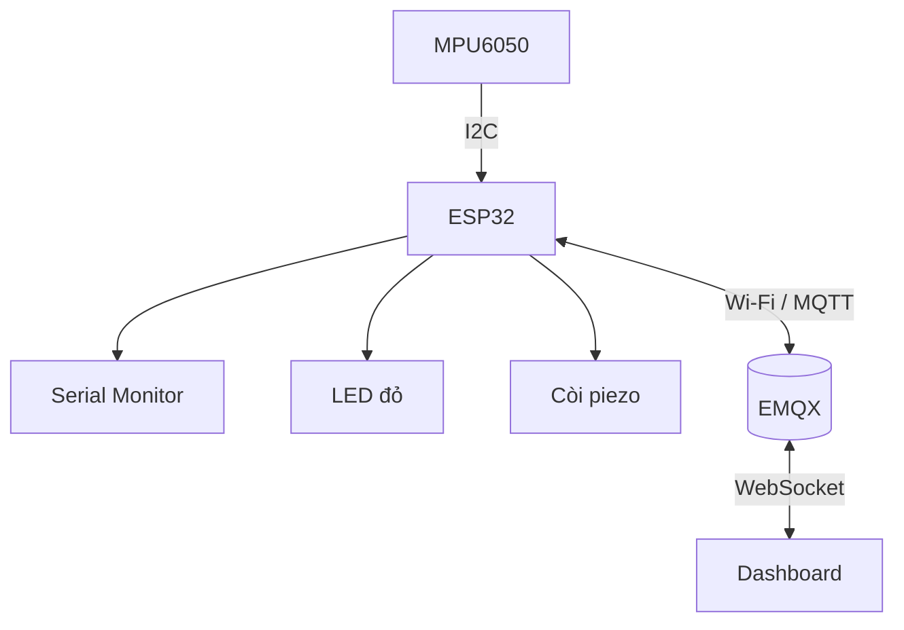
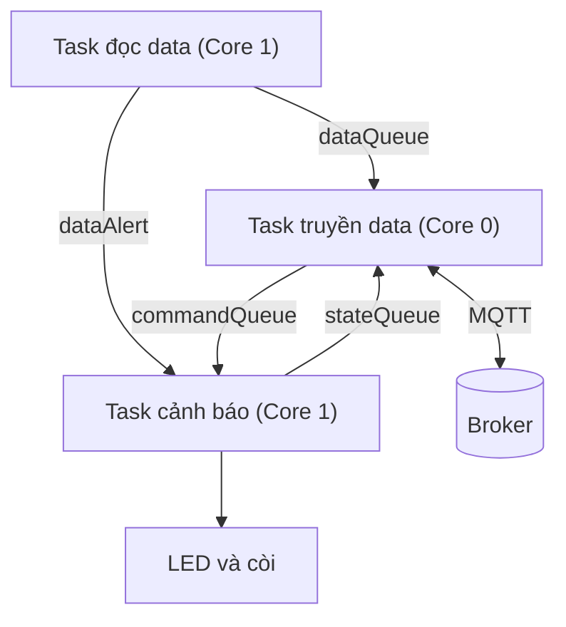
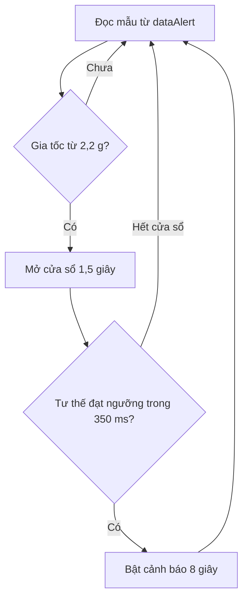

# Lab 3: Phát hiện té ngã bằng ESP32, MPU6050 và FreeRTOS

**Đề bài.** Thiết kế mạch phát hiện té ngã dựa trên gia tốc đột ngột và sự thay đổi góc nghiêng của cơ thể. ESP32 đọc MPU6050, hiển thị số đo qua Serial và gửi dữ liệu lên MQTT Broker qua Wi-Fi. Web hiển thị gia tốc, góc nghiêng và hai biểu đồ thời gian thực, đồng thời có hai nút bật/tắt LED và còi ở chế độ thủ công. Hệ thống gồm ba task FreeRTOS chạy trên hai core.

| Mục | Liên kết |
|---|---|
| Mô phỏng Wokwi | [Tạo dự án ESP32 và nhập mã nguồn](https://wokwi.com/projects/480588881922549761) |
| Code ESP32 | [sketch.ino](sketch.ino) |
| Sơ đồ mạch | [diagram.json](diagram.json) |
| Giao diện Web | [Mở dashboard Giám sát té ngã](https://thanhchi05.github.io/NguyenChiThanh_231432348-de5/dashboard.html) |
| Video mô phỏng | [Nội dung demo](video/README.md) · Chưa có video đính kèm |
| Báo cáo | [Xem báo cáo Word bài Lab](t%C3%A0i%20li%E1%BB%87u/Bao_cao_qua_trinh_phat_hien_te_nga.docx) |

---

## 1. Giới thiệu RTOS và FreeRTOS

### 1.1. RTOS là gì

RTOS (Real-Time Operating System) là hệ điều hành thời gian thực dành cho vi điều khiển. RTOS chia chương trình thành nhiều **task** (tác vụ) chạy song song. Bộ lập lịch (scheduler) quyết định task nào được chạy dựa trên **mức ưu tiên**, nhờ đó các việc quan trọng luôn được xử lý đúng hạn.

### 1.2. Ưu điểm của RTOS

| Ưu điểm | Giải thích |
|---|---|
| Đa nhiệm | Nhiều công việc chạy song song: đọc cảm biến, gửi mạng, điều khiển thiết bị. Việc này không phải chờ việc kia. |
| Đáp ứng thời gian thực | Task ưu tiên cao được chạy ngay khi sẵn sàng, đảm bảo phản ứng nhanh với sự kiện. |
| Code dễ tổ chức | Mỗi task làm một việc riêng nên dễ đọc, dễ sửa, dễ mở rộng. |
| Tiết kiệm CPU | Task đang chờ (`vTaskDelay`, chờ hàng đợi) không chiếm CPU, thay cho việc liên tục kiểm tra điều kiện bằng vòng lặp. |
| Có sẵn cơ chế giao tiếp | Queue, Semaphore, Mutex giúp các task trao đổi dữ liệu an toàn. |

### 1.3. FreeRTOS

FreeRTOS là RTOS mã nguồn mở phổ biến cho vi điều khiển. Trên ESP32, FreeRTOS đã được tích hợp sẵn trong ESP-IDF và Arduino core, nên không cần cài thêm.

| Ưu điểm | Nhược điểm |
|---|---|
| Miễn phí, mã nguồn mở (giấy phép MIT) | Tốn thêm RAM cho mỗi task (stack riêng) |
| Nhỏ gọn, nhân chỉ vài KB | Khó gỡ lỗi hơn chương trình tuần tự (lỗi tranh chấp tài nguyên, tràn stack) |
| Hỗ trợ rất nhiều dòng chip (ESP32, STM32, AVR...) | Phải tính toán ưu tiên, kích thước stack cho hợp lý |
| Tài liệu và cộng đồng lớn | Nếu thiết kế sai có thể gặp deadlock hoặc đảo ngược ưu tiên |
| Trên ESP32 hỗ trợ chạy 2 core (SMP) | Không có sẵn hệ thống file, mạng như hệ điều hành lớn |

---

## 2. Cơ chế giao tiếp giữa các task

### 2.1. Hàng đợi (Queue)

Queue là bộ đệm FIFO (vào trước ra trước) có số phần tử cố định. Task gửi dùng `xQueueSend`, task nhận dùng `xQueueReceive`. Dữ liệu được **sao chép** vào hàng đợi, nên hai task không dùng chung biến và không bị xung đột.

**Ưu điểm:**
1. Truyền dữ liệu an toàn giữa các task, kể cả các task chạy ở hai core khác nhau.
2. Task nhận có thể ngủ chờ đến khi có dữ liệu, không tốn CPU.
3. Hàng đợi có dung lượng nên giữ được dữ liệu khi bên nhận đang bận.

**Ứng dụng:** chuyển dữ liệu cảm biến sang task gửi mạng, chuyển lệnh điều khiển sang task chấp hành, nhận dữ liệu từ ngắt (ISR).

### 2.2. Cờ hiệu (Semaphore)

Semaphore là cờ báo hiệu dùng để **đồng bộ** hoặc **bảo vệ tài nguyên**, không mang dữ liệu.

| Loại | Cách hoạt động | Ứng dụng |
|---|---|---|
| Binary Semaphore | Chỉ có 2 trạng thái 0 và 1. Một bên `Give`, bên kia `Take`. | Báo sự kiện, ví dụ ngắt nút nhấn báo cho task xử lý |
| Counting Semaphore | Đếm được nhiều lần `Give` | Quản lý số tài nguyên có hạn, đếm sự kiện |
| Mutex | Semaphore đặc biệt, có kế thừa ưu tiên | Bảo vệ tài nguyên dùng chung như Serial, I2C, biến toàn cục |

**Ưu điểm:**
1. Đồng bộ các task với nhau hoặc với ngắt.
2. Tránh hai task cùng ghi vào một tài nguyên.
3. Task chờ semaphore không tốn CPU.

### 2.3. So sánh

| Tiêu chí | Queue | Semaphore |
|---|---|---|
| Mang dữ liệu | Có | Không |
| Mục đích chính | Truyền dữ liệu | Đồng bộ, bảo vệ tài nguyên |
| Dùng trong bài | `dataQueue`, `dataAlert` | Có thể mở rộng: Mutex cho Serial |

---

## 3. Các bước thực hiện

### 3.1. Sơ đồ khối hệ thống



### 3.2. Sơ đồ mạch trên Wokwi

Mở [diagram.json](diagram.json) trong Wokwi để xem sơ đồ nối dây.

| Thiết bị | Chân thiết bị | Chân ESP32 | Ghi chú |
|---|---|---|---|
| MPU6050 | VCC | 3V3 | Nguồn |
| MPU6050 | GND | GND | Mass chung |
| MPU6050 | SDA | GPIO21 | Dữ liệu I2C |
| MPU6050 | SCL | GPIO22 | Xung nhịp I2C |
| LED đỏ | A | GPIO25 | Qua điện trở 220 Ω |
| LED đỏ | C | GND | Cathode |
| Còi piezo | 2 (+) | GPIO26 | Phát âm 2,2 kHz |
| Còi piezo | 1 (−) | GND | Mass chung |

Thư viện sử dụng ([libraries.txt](libraries.txt))

| Thư viện | Công dụng |
|---|---|
| `WiFi.h` | Kết nối Wi-Fi |
| `Wire.h` | Đọc thanh ghi MPU6050 qua I2C |
| `PubSubClient` | Gửi dữ liệu và nhận lệnh MQTT |

### 3.3. Triển khai FreeRTOS trên ESP32

| Task | Core | Ưu tiên | Stack (byte) | Chu kỳ | Nhiệm vụ |
|---|---:|---:|---:|---|---|
| Task truyền data (`transmitTask`) | 0 | 1 | 6144 | Gửi mỗi 250 ms khi có dữ liệu | Kết nối Wi-Fi/MQTT, gửi mẫu mới nhất và nhận lệnh điều khiển |
| Task đọc data (`readTask`) | 1 | 2 | 4096 | Lấy mẫu 20 ms, in Serial 250 ms | Đọc MPU6050, tính gia tốc tổng hợp và góc nghiêng, chuyển mẫu vào hai hàng đợi |
| Task cảnh báo (`alertTask`) | 1 | 3 | 4096 | Kiểm tra hàng đợi mỗi vòng, nghỉ 10 ms | Phát hiện té ngã và điều khiển LED/còi |

| Hàng đợi | Kích thước | Kiểu phần tử | Gửi | Nhận | Lý do chọn |
|---|---:|---|---|---|---|
| `dataQueue` | 1 | `Sample` | Task đọc | Task truyền | Ghi đè bằng mẫu mới nhất |
| `dataAlert` | 24 | `Sample` | Task đọc | Task cảnh báo | Giữ thứ tự các mẫu để nhận biết xung va chạm |
| `commandQueue` | 12 | `Command` | Task truyền hoặc task đọc Serial | Task cảnh báo | Chuyển lệnh điều khiển và kiểm thử |
| `stateQueue` | 1 | `OutputState` | Task cảnh báo | Task truyền | Cung cấp trạng thái mới nhất cho dashboard |

**Kiến trúc RTOS và luồng dữ liệu giữa các task**



**Thuật toán phát hiện té ngã**

Gia tốc tổng hợp tính bằng `sqrt(ax² + ay² + az²)`. Góc nghiêng so với trục +Z của cảm biến tính bằng `atan2(sqrt(ax² + ay²), az)` rồi đổi sang độ. Mẫu có gia tốc tổng hợp gần 1 g được dùng để ước lượng tư thế theo trọng lực.

| Giai đoạn | Điều kiện | Xử lý |
|---|---|---|
| Theo dõi | Gia tốc 0,8–1,2 g | Cập nhật góc tham chiếu |
| Va chạm | Gia tốc từ 2,2 g | Mở cửa sổ xác nhận 1,5 giây |
| Xác nhận tư thế | Góc từ 60°, chênh ít nhất 45° so với tham chiếu và gia tốc 0,8–1,2 g | Giữ đủ 350 ms liên tục trong cửa sổ xác nhận |
| Cảnh báo | Xác nhận té ngã | Bật LED và còi 8 giây ở chế độ tự động |



Giải pháp triển khai

1. Xác nhận tư thế sau va chạm để giảm cảnh báo do chỉ có xung gia tốc hoặc chỉ có thay đổi góc.
2. Cảnh báo tại chỗ chạy độc lập với kết nối MQTT.
3. Task cảnh báo quản lý cả chế độ tự động và thủ công để điều khiển chung hai ngõ ra.
4. Khi thử trên phần cứng, đặt trục +Z hướng lên khi người đứng và hiệu chỉnh ngưỡng theo vị trí gắn cảm biến.

### 3.4. Giao thức MQTT

ESP32 dùng TCP cổng 1883. Dashboard dùng `wss://broker.emqx.io:8084/mqtt`.

| Topic | Chiều | Nội dung ví dụ |
|---|---|---|
| `utc/fall/8c317a82dd624959/telemetry` | ESP32 → Web | `{"ms":1000,"ax":0,"ay":0,"az":1,"g":1,"tilt":0,"fall":false,"manual":false,"led":false,"buzzer":false}` |
| `utc/fall/8c317a82dd624959/cmd` | Web → ESP32 | `auto`, `manual`, `led:on`, `led:off`, `buzzer:on`, `buzzer:off` |

### 3.5. Giao diện Web

File [dashboard.html](dashboard.html) dùng MQTT.js để kết nối broker và Canvas để vẽ hai biểu đồ.

| Thành phần | Thẻ HTML | Chức năng |
|---|---|---|
| Gia tốc | `<div class="value">` chứa `magnitude` | Hiển thị gia tốc tổng hợp và kèm số đo X/Y/Z |
| Góc nghiêng | `<div class="value">` chứa `tilt` | Hiển thị góc theo độ |
| Biểu đồ gia tốc | `<canvas id="acceleration">` | Hiển thị dữ liệu khoảng 15 giây gần nhất |
| Biểu đồ góc nghiêng | `<canvas id="inclination">` | Hiển thị dữ liệu khoảng 15 giây gần nhất |
| Nút LED | `<button id="led">` | Bật/tắt LED trong chế độ thủ công |
| Nút còi | `<button id="buzzer">` | Bật/tắt còi trong chế độ thủ công |
| Chọn chế độ | `<select id="mode">` | Chuyển giữa Tự động và Thủ công |

---

## 4. Code và giải thích

Code đầy đủ nằm trong [sketch.ino](sketch.ino).

### 4.1. Khởi tạo hàng đợi và task

```cpp
dataQueue = xQueueCreate(1, sizeof(Sample));
dataAlert = xQueueCreate(24, sizeof(Sample));
commandQueue = xQueueCreate(12, sizeof(Command));
stateQueue = xQueueCreate(1, sizeof(OutputState));

xTaskCreatePinnedToCore(alertTask, "Task canh bao", 4096, nullptr, 3, nullptr, 1);
xTaskCreatePinnedToCore(readTask, "Task doc data", 4096, nullptr, 2, nullptr, 1);
xTaskCreatePinnedToCore(transmitTask, "Task truyen data", 6144, nullptr, 1, nullptr, 0);
```

Tham số cuối của `xTaskCreatePinnedToCore` chọn core. Task truyền chạy Core 0. Task đọc và task cảnh báo chạy Core 1.

### 4.2. Tạo kết nối Wi-Fi và MQTT (Task truyền data, Core 0)

```cpp
WiFi.mode(WIFI_STA);
WiFi.setAutoReconnect(true);
WiFi.begin(WIFI_SSID, WIFI_PASSWORD);
mqtt.setServer(BROKER, 1883);
mqtt.setCallback(onCommand);
mqtt.setSocketTimeout(2);
```

Trong Wokwi, ESP32 dùng mạng `Wokwi-GUEST`. Task truyền thử kết nối lại MQTT khi Wi-Fi sẵn sàng và đăng ký topic lệnh sau khi kết nối thành công.

### 4.3. Cập nhật dữ liệu

**Task đọc data** lấy mẫu qua I2C. Mẫu hợp lệ được in lên Serial định kỳ và đưa vào hàng đợi truyền. Hàng đợi cảnh báo nhận mẫu theo thứ tự để kiểm tra điều kiện theo thời gian.

```cpp
s.magnitude = sqrtf(s.x*s.x + s.y*s.y + s.z*s.z);
s.tilt = atan2f(hypotf(s.x, s.y), s.z) * RAD_TO_DEG;
```

**Task truyền data** lấy mẫu mới nhất và trạng thái ngõ ra, định dạng thành JSON rồi gửi lên broker.

```cpp
mqtt.publish(telemetryTopic, payload, false);
```

**Web** nhận JSON, cập nhật hai ô số và vẽ lại biểu đồ.

```js
byId('magnitude').textContent = live ? sample.g.toFixed(2) : '—';
byId('tilt').textContent = live ? sample.tilt.toFixed(1) : '—';
```

### 4.4. Điều khiển

**Điều khiển tự động LED và còi (Task cảnh báo, Core 1)**

```cpp
const bool led = outputTest || (state.manual ? manualLed : state.fall);
const bool buzzer = outputTest || (state.manual ? manualBuzzer : state.fall);
if (led != state.led) digitalWrite(LED_PIN, led);
if (buzzer != state.buzzer) {
  if (buzzer) tone(BUZZER_PIN, 2200);
  else noTone(BUZZER_PIN);
}
```

**Điều khiển thủ công LED và còi từ Web**

```js
led.onclick = () => send(sample.led ? 'led:off' : 'led:on', 'led', !sample.led);
buzzer.onclick = () => send(sample.buzzer ? 'buzzer:off' : 'buzzer:on', 'buzzer', !sample.buzzer);
```

Web gửi lệnh qua topic `cmd`. Task truyền chuyển lệnh vào `commandQueue`. Task cảnh báo cập nhật ngõ ra. Dashboard dùng dữ liệu trạng thái trong bản tin telemetry để xác nhận.

---

## 5. Kết quả

### 5.1. Mô phỏng trên Wokwi và Serial Monitor

Khi MPU6050 ở tư thế mặc định, Serial Monitor dự kiến hiển thị:

```text
ax=0.00 ay=0.00 az=1.00 |a|=1.00 g tilt=0.0 deg
```

### 5.2. Kiểm thử phát hiện té ngã

| Bài thử | Thao tác | Kết quả mong đợi |
|---|---|---|
| Kiểm tra ngõ ra | Nhập `o` trong Serial Monitor | LED và còi bật 3 giây |
| Mô phỏng cú ngã | Nhập `f` để tạo chuỗi đứng → va chạm → nằm ngang | In `FALL DETECTED` và bật LED/còi 8 giây |
| Chỉ nghiêng | Đổi tư thế từ từ, giữ gia tốc tổng hợp dưới ngưỡng va chạm | LED và còi giữ trạng thái tắt trong chế độ tự động |

### 5.3. Giao diện Web và điều khiển

Mở [dashboard.html](dashboard.html) khi Wokwi đang chạy. Quan sát hai ô số, hai biểu đồ và trạng thái cảnh báo. Chọn **Thủ công**, sau đó thử từng nút **Đèn LED** và **Còi** và đối chiếu với trạng thái trên Wokwi.

### 5.4. Bảng kiểm tra

| Nội dung kiểm tra | Trạng thái |
|---|---|
| Sơ đồ ESP32, MPU6050, LED và còi | Có trong `diagram.json` |
| Ba task trên đúng core và truyền mẫu qua hai hàng đợi | Có trong firmware |
| Đèn và còi hoạt động trên Wokwi | Đã thử ngõ ra |
| Chuỗi đứng → va chạm → nằm ngang | Đã kiểm tra logic bằng dữ liệu giả lập |
| Chỉnh MPU6050 và quan sát số đo trên Serial | Đối chiếu khi chạy mô phỏng |
| Web hiện số đo và cập nhật hai biểu đồ từ ESP32 | Cần xác nhận MQTT đầu cuối |
| Web bật/tắt độc lập LED và còi | Cần xác nhận MQTT hai chiều |

---

## 6. Kết luận

1. ESP32 đọc gia tốc ba trục và tính góc nghiêng từ MPU6050, in số đo qua Serial và gửi telemetry qua Wi-Fi/MQTT.
2. Ba task FreeRTOS chia công việc giữa hai core. `dataQueue` chuyển mẫu cho task truyền và `dataAlert` chuyển mẫu cho task cảnh báo.
3. Cảnh báo tự động dựa trên cả xung gia tốc và tư thế sau va chạm.
4. Dashboard có số đo dạng số, hai biểu đồ thời gian thực và hai nút điều khiển thủ công.

**Hướng phát triển.** Hiệu chỉnh ngưỡng với dữ liệu đo thực tế, bổ sung bộ lọc kết hợp gia tốc kế và con quay hồi chuyển, và lưu lịch sử cảnh báo.

---

## 7. Hướng dẫn chạy

1. Tạo dự án ESP32 trên Wokwi. Dán [sketch.ino](sketch.ino) và [diagram.json](diagram.json) vào các tab tương ứng. Thêm **PubSubClient** trong **Library Manager**.
2. Bấm **Start Simulation**. Quan sát Serial Monitor và dùng `o` để thử ngõ ra hoặc `f` để thử thuật toán.
3. Mở [dashboard.html](dashboard.html) bằng trình duyệt. Giữ Wokwi chạy để nhận số đo và thử điều khiển LED/còi ở chế độ **Thủ công**.
4. Nếu web đã kết nối MQTT nhưng vẫn hiện dấu gạch ngang, xem dòng `MQTT connected` hoặc `MQTT connect failed, state=...` trên Serial. Kiểm tra topic trong code ESP32 trùng topic trong dashboard.

## 8. Tài liệu tham khảo

1. [FreeRTOS Documentation](https://www.freertos.org/Documentation)
2. [ESP-IDF FreeRTOS](https://docs.espressif.com/projects/esp-idf/en/latest/esp32/api-reference/system/freertos.html)
3. [Wokwi MPU6050](https://docs.wokwi.com/parts/wokwi-mpu6050)
4. [PubSubClient](https://pubsubclient.knolleary.net/)
5. [MQTT.js](https://github.com/mqttjs/MQTT.js)
6. [EMQX Public MQTT Broker](https://www.emqx.com/en/mqtt/public-mqtt5-broker)
